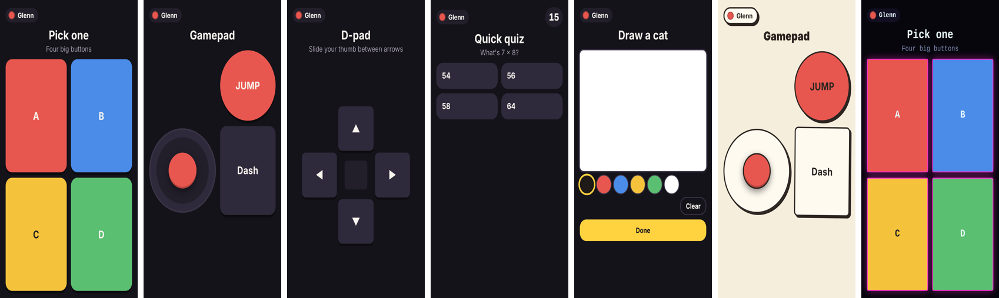

# PocketPad

Turn phones into game controllers for [s&box](https://sbox.game). Players open a link on their phone,
type a 4-letter room code and play. No app install, no Steam account.



PocketPad has three parts:

| Part | What it is | Where |
|---|---|---|
| **Server** | A small Node.js server you host yourself (Docker image provided). It serves the phone page and relays messages between your game and the phones. | [`server/`](server) |
| **Phone client** | A web page with no build step: buttons, d-pad, joystick, touchpad, swipes, sliders, text and number entry, multiple choice, drawing, tilt and shake, plus vibration, sounds, flashes and pop-up messages. | [`server/public/`](server/public) |
| **s&box library** | C# you drop into your game: start a session, describe each phone screen in code, read input as events or by polling. | [`sbox/`](sbox) |

It started as a replacement for Facepunch's retired Juicebox service and goes further: richer controls,
live updates, per-player screens and colours, feedback effects, and full branding.

## Why it's different

- **Your layout, every moment.** There's no fixed gamepad. Each `Show(...)` describes the phone screen
  for that moment out of building blocks, so one microgame can be a single MASH button, the next a
  joystick with two buttons, the next a drawing canvas. Send it to everyone, one player, or a team.
- **Live updates.** Change one element without redrawing: move a progress bar, relabel a button, disable
  a control, change the countdown.
- **Feedback on the phone.** Haptics (Android), synthesised sounds (no audio files needed), colour flashes,
  screen shake and big toast messages.
- **Built to be branded.** Themes set colours, logo, fonts, sounds, extra CSS, and can even add their own
  control types with a small script. See [docs/theming.md](docs/theming.md).
- **Reconnects properly.** A phone that refreshes or drops off Wi-Fi comes back as the same player with the
  same screen. A game that loses the server reconnects to the same session.
- **Self-hosted.** One Docker container, in-memory, no database. Run it on your PC for development or on
  any VPS for production.

## Quick start

### 1. Run the server

```bash
docker run -d --name pocketpad -p 8080:8080 -e PUBLIC_URL=http://YOUR-PC-IP:8080 ghcr.io/gmcclelland90/sbox-pocketpad:latest
```

`PUBLIC_URL` is the address phones use. For testing on home Wi-Fi, that's your PC's LAN IP
(`ipconfig` on Windows). Without Docker: `cd server && npm install && npm start` (Node 20+).
More options in [docs/self-hosting.md](docs/self-hosting.md).

Try it without s&box: `cd server && node tools/demo-host.js http://localhost:8080`, then open the
printed link on your phone and press Enter to step through every control.

### 2. Add the library to your game

Copy `sbox/` into your project as `Libraries/pocketpad/`:

```powershell
powershell -ExecutionPolicy Bypass -File tools\install-library.ps1 -Project "C:\path\to\mygame"
```

(or `tools/install-library.sh /path/to/mygame` on macOS/Linux).

### 3. Use it

Add a **PocketPad Host** component to an object in your scene (Server Url `http://localhost:8080`), then:

```csharp
using PocketPad;

public sealed class MyGame : Component
{
	protected override void OnStart()
	{
		Components.Get<PadHost>().OnSession( session =>
		{
			session.Ready += _ => Log.Info( $"Join at {session.JoinUrl} with code {session.Code}" );

			session.PlayerJoined += player =>
			{
				player.Show( new PadScreen( "Get ready!", "Watch the TV" ) );
			};

			session.Input += input =>
			{
				if ( input.Is( "jump", PadInputKind.Down ) )
					input.Player.Feedback( PadFeedback.Good( "Boing!" ) );
			};
		} );
	}

	void StartRace( PadSession session )
	{
		// A screen is just a list of controls. Lay them out however each moment needs.
		session.Show( new PadScreen( "Race!" ) { Timer = 30, Layout = "row" }.Add(
			Pad.Joystick( "move" ),
			Pad.Column(
				new PadButton { Id = "jump", Label = "JUMP", Shape = "round", Color = "player" },
				Pad.Progress( "boost", 0, "Boost" ) ) ) );
	}

	protected override void OnUpdate()
	{
		var session = PadHost.Current?.Session;
		if ( session is null ) return;
		foreach ( var p in session.Players )
		{
			Vector2 stick = p.Stick( "move" );     // polling works too
			if ( p.WasPressed( "jump" ) ) { /* ... */ }
		}
	}
}
```

The full API, every control and how input arrives: [docs/sbox.md](docs/sbox.md).

### Example project

[`examples/playground`](examples/playground) is a tiny s&box game: everyone who joins drives a cube, and
you press 1 to 6 to switch every phone between a gamepad, d-pad, mash meter, quiz, drawing and tilt
controls. The HUD shows the room code, a QR code and each player's last input.

## Repository layout

```
server/            Node.js server, phone client (public/), built-in themes, tests, Dockerfile
sbox/              s&box library (copy to YourGame/Libraries/pocketpad)
examples/          playground s&box project, and a theme with a custom control
docs/              protocol, theming, self-hosting, s&box API
tools/             library install scripts
docker-compose.yml one-command local server with a themes folder
```

## Docs

- [s&box library guide](docs/sbox.md)
- [Theming and custom controls](docs/theming.md)
- [Self-hosting](docs/self-hosting.md)
- [Protocol reference](docs/protocol.md) (for writing clients in other engines)

## Development

```bash
cd server
npm install
npm test            # protocol tests: fake game + fake phones against a real server
npm run dev         # restart on change
node tools/demo-host.js --theme paper   # drive phones without s&box
```

Pushes to `main` publish `ghcr.io/gmcclelland90/sbox-pocketpad:edge`; tags like `v1.2.3` publish
`1.2.3`, `1.2`, `1` and `latest`.

## License

MIT. Use it in jam games, commercial games, anything.
